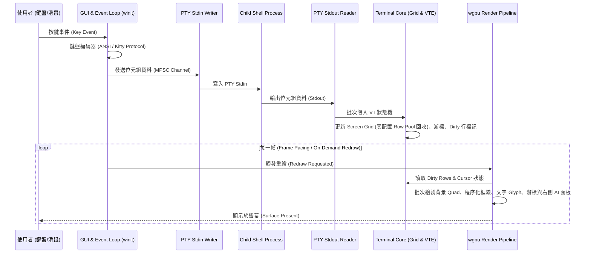

# 00. 系统整體架構規格 (Architecture Overview)

## 1. 目標與定位
`skTerm` 是一套專為 **macOS**、**Windows** 與 **Linux** 設計的現代化、高效能、純原生編譯的 GPU 加速終端模擬器。
- **極致效能**：基於 `wgpu` 實現全 GPU 硬體加速渲染，支援 120Hz+ ProMotion / G-Sync 高更新率與低於 5ms 的輸入延遲。
- **標準相容**：完整相容 DEC VT100 / VT220 / xterm / xterm-256color / 24-bit TrueColor RGB 規範。
- **現代功能**：內建多分頁（Tabs）、二元空間分割窗格（Split Panes & Zoom）、全域跨分頁 AI Agent 監控面板、即時搜尋（`Cmd+F`）、Kitty 鍵盤協定、OSC 8 與純文字網址自動偵測超連結、程序化無縫框線繪製（Procedural Box Drawing）、剪貼簿圖片直接貼上轉路徑，以及 Sixel/Kitty 圖像協定。
- **模組化設計**：核心邏輯、GPU 渲染、GUI 視窗與應用入口嚴格解耦。

---

## 2. 執行緒模型與資料流 (Threading & Data Flow)

系統採用多執行緒解耦架構，確保耗時的 PTY I/O 與 VT 狀態機解析不會阻塞 60/120 FPS 的 UI 渲染與視窗事件迴圈，並於閒置時進入零耗電休眠 (`ControlFlow::Wait` / `WaitUntil`)：

---

## 3. Workspace 模組邊界與職責

| Crate 名稱 | 職責定義 | 外部關鍵依賴 |
| :--- | :--- | :--- |
| `skterm-core` | PTY 行程抽象、DEC VT 狀態機、Screen Grid 雙緩衝與零配置行回收池 (`RowPool`)、動態 Reflow（保留 Hard Prompt）、全緩衝區搜尋、前景行程與 OSC 7 工作目錄追蹤、純文字 URL 偵測 | `portable-pty`, `vte`, `unicode-width` |
| `skterm-render` | wgpu 渲染管線、VSCode 多字體回退與智慧字重匹配、動態 Glyph Atlas 快取、程序化無縫框線 (`box_drawing`)、全域 AI 面板幾何單一來源 (`agent_panel`)、互動捲軸與搜尋高亮渲染 | `wgpu`, `cosmic-text`, `fontdue`, `bytemuck` |
| `skterm-gui` | 視窗與膠囊分頁管理、macOS 原生標題列 `AI` 按鈕配件 (`macos_titlebar`)、原生 `NSTextField` 內嵌編輯器、macOS HIG 偏好設定視窗、BSP 窗格切分與縮放、剪貼簿圖片貼上、原子化設定檔讀寫與熱重載 | `winit`, `egui`, `egui-wgpu`, `arboard`, `notify`, `toml`, `objc` |
| `skterm-app` | CLI 參數解析、日誌初始化、Release LTO 最佳化配置、各模組組裝與應用程式入口 | `tracing`, `tracing-subscriber`, `anyhow` |
