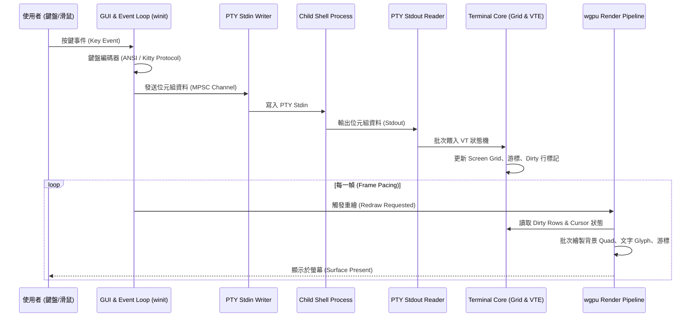

# 00. 系统整體架構規格 (Architecture Overview)

## 1. 目標與定位
`skTerm` 是一套專為 **macOS**、**Windows** 與 **Linux** 設計的現代化、高效能、純原生編譯的 GPU 加速終端模擬器。
- **極致效能**：基於 `wgpu` 實現全 GPU 硬體加速渲染，支援 120Hz+ ProMotion / G-Sync 高更新率與低於 5ms 的輸入延遲。
- **標準相容**：完整相容 DEC VT100 / VT220 / xterm / xterm-256color / 24-bit TrueColor RGB 規範。
- **現代功能**：內建多分頁（Tabs）、二元空間分割窗格（Split Panes）、Kitty 鍵盤協定、OSC 8 超連結與 Sixel/Kitty 圖像協定。
- **模組化設計**：核心邏輯、GPU 渲染、GUI 視窗與應用入口嚴格解耦。

---

## 2. 執行緒模型與資料流 (Threading & Data Flow)

系統採用多執行緒解耦架構，確保耗時的 PTY I/O 與 VT 狀態機解析不會阻塞 60/120 FPS 的 UI 渲染與視窗事件迴圈：

---

## 3. Workspace 模組邊界與職責

| Crate 名稱 | 職責定義 | 外部關鍵依賴 |
| :--- | :--- | :--- |
| `skterm-core` | PTY 行程抽象、DEC VT 狀態機、Screen Grid 雙緩衝、Unicode/CJK 寬度處理、Damage Tracking | `portable-pty`, `vte`, `unicode-width` |
| `skterm-render` | wgpu 渲染管線、動態 Glyph Atlas 快取、WGSL 著色器（背景、文字、游標、選取區）、16 色 ANSI 調色盤管理 | `wgpu`, `cosmic-text`, `fontdue`, `bytemuck` |
| `skterm-gui` | 視窗管理、macOS HIG 獨立偏好設定視窗 (`PreferencesWindow`)、BSP 窗格切分、即時主題同步、視窗尺寸防抖自動存檔、鍵盤/滑鼠事件路由、剪貼簿、設定檔熱重載 | `winit`, `egui`, `egui-wgpu`, `arboard`, `notify`, `toml` |
| `skterm-app` | CLI 參數解析、日誌初始化、各模組組裝與應用程式入口 | `tracing`, `tracing-subscriber`, `anyhow` |
