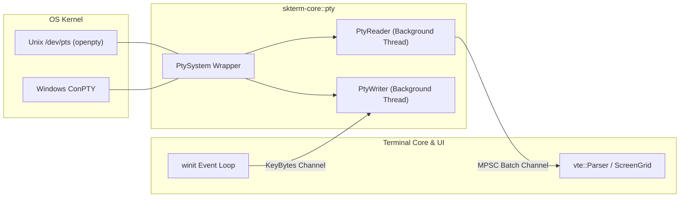

# 02. PTY 跨平台抽象與事件迴圈規格 (PTY & Event Loop)

## 1. 跨平台 PTY 架構

透過 `portable-pty` 實現統一的作業系統底層終端抽象：
- **Windows**：調用 Windows ConPTY API (`CreatePseudoConsole`)，由系統核心負責虛擬終端轉譯。
- **macOS / Linux**：調用 POSIX `openpty()` / `forkpty()`，配置 `termios` 模式與信號捕捉 (`SIGWINCH`)。

---

## 2. 視窗尺寸變更 (Resize Handling)
當 UI 視窗尺寸改變時：
1. 計算新網格尺寸：`cols = floor(width / cell_width)`, `rows = floor(height / cell_height)`。
2. 發送 `PtySize { rows, cols, pixel_width, pixel_height }` 至 PTY。
3. Unix 自動觸發 `ioctl(TIOCSWINSZ)` 並向子行程發送 `SIGWINCH` 信號；Windows 更新 ConPTY 緩衝區尺寸。
4. Terminal Core 執行 `grid.resize(rows, cols)` 與 Reflow。
