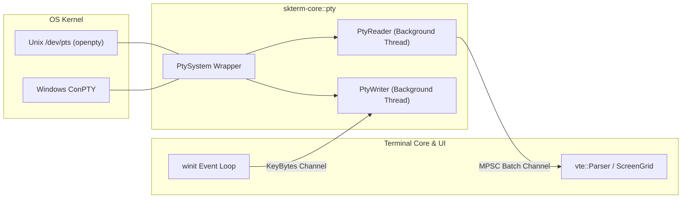

# 02. PTY 跨平台抽象與事件迴圈規格 (PTY & Event Loop)

## 1. 跨平台 PTY 架構

透過 `portable-pty` 實現統一的作業系統底層終端抽象：
- **Windows**：調用 Windows ConPTY API (`CreatePseudoConsole`)，由系統核心負責虛擬終端轉譯。
- **macOS / Linux**：調用 POSIX `openpty()` / `forkpty()`，配置 `termios` 模式與信號捕捉 (`SIGWINCH`)。

---

## 2. 視窗尺寸變更 (Resize Handling)
當 UI 視窗尺寸改變時：
1. 計算新網格尺寸：`cols = floor(width / cell_width)`, `rows = floor(height / cell_height)`。
2. 發送 `PtySize { rows, cols, pixel_width, pixel_height }` 至 PTY。
3. Unix 自動觸發 `ioctl(TIOCSWINSZ)` 並向子行程發送 `SIGWINCH` 信號；Windows 更新 ConPTY 緩衝區尺寸。
4. Terminal Core 執行 `grid.resize(rows, cols)` 與 Reflow。

---

## 3. 零閒置耗電事件迴圈調度 (Idle-Power Event Loop Scheduling)
- **動態休眠策略 (`ControlFlow::Wait` vs `WaitUntil`)**：
  - 當終端無新 PTY 輸出且游標處於靜止或視窗失焦時，事件迴圈自動切換為 `ControlFlow::Wait`，完全釋放 CPU，達成 **0.0% 閒置 CPU 佔用率**。
  - 僅在需要處理游標閃爍定時器（`blink_interval_ms`）或 AI Agent 狀態輪詢時，以精確的 `ControlFlow::WaitUntil(next_deadline)` 喚醒，避免無意義的高頻忙碌輪詢（Busy Polling）。

---

## 4. Shell 啟動環境與工作目錄繼承 (Login Shell & CWD Inheritance)
- **macOS Login Shell 環境變數初始化**：
  - 在 macOS 從 Finder / Dock 啟動 `.app` 時，自動以 Login Shell（如 `/bin/zsh -l`）啟動並注入 `TERM=xterm-256color`、`COLORTERM=truecolor`、`LANG` 等環境變數，確保使用者於 `~/.zprofile` / `~/.zshrc` 設定之 Homebrew、Rust Cargo、NVM 等 `PATH` 完整載入。
- **工作目錄自動繼承 (CWD Inheritance)**：
  - 新增分頁（`Cmd + T`）或切分窗格（`Cmd + D` / `Cmd + Shift + D`）時，優先讀取當前焦點窗格的 `OSC 7` 工作目錄或透過系統行程表查詢子 Shell 當前 CWD，自動於該目錄下啟動新 Shell。
