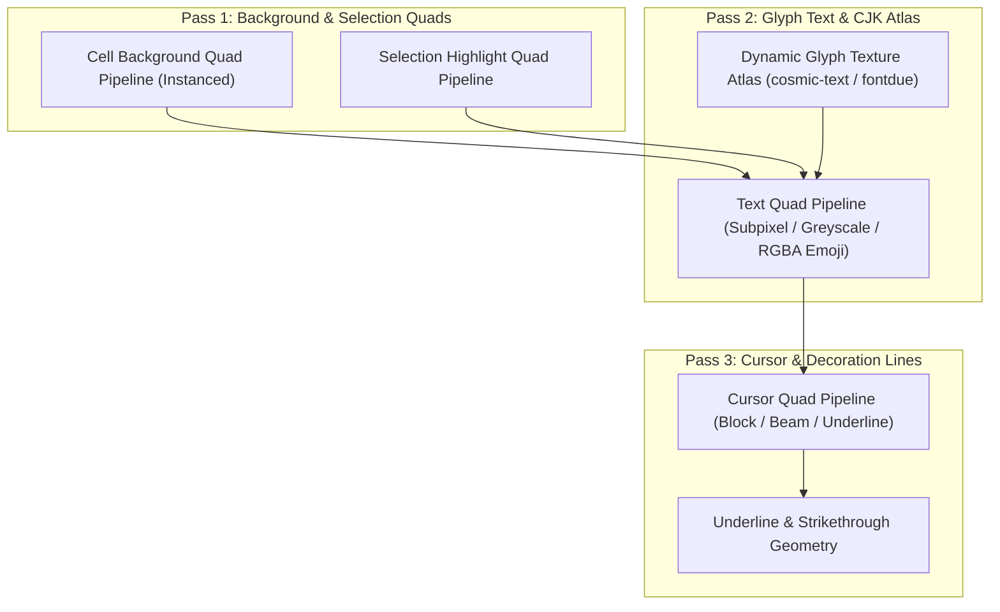

# 03. wgpu GPU 渲染管線與文字排版規格 (GPU Rendering Pipeline)

## 1. 渲染架構與目標
- **後端支援**：macOS (Metal)、Windows (DirectX 12 / Vulkan)、Linux (Vulkan / OpenGL)。
- **目標幀率**：支援 60Hz / 120Hz+ ProMotion / G-Sync。
- **零閒置耗電 (Damage Tracking)**：僅在畫面網格存在 Dirty lines、游標閃爍或動畫時提交 GPU RenderPass。

---

## 2. 渲染階段劃分 (Render Pipeline Passes)

渲染分為三層主要的繪圖流程：

---

## 3. 動態 Glyph Atlas 設計
- 維護一張尺寸為 2048x2048 的動態 GPU 紋理（`wgpu::TextureFormat::R8Unorm` 為灰階文字，`Rgba8UnormSrgb` 為彩色 Emoji）。
- 利用 LRU（Least Recently Used）演算法管理字元快取。
- 支援 CJK 字元動態回退（Fallback Fonts）與字形連字（Font Ligatures）。

---

## 4. 主題色彩即時切換與 Uniform 動態更新 (Zero-Rebuild Theme Updates)
- 主題色彩（包含預設背景色、前景色、游標色、選取區色彩、16 色 ANSI 調色盤）封裝於輕量 GPU Uniform 緩衝區中。
- 當使用者在偏好設定中切換主題或調整顏色時，僅需向 GPU 提交 Uniform 緩衝區寫入 (`queue.write_buffer`) 並呼叫 `request_redraw()`，**無需重建 WGPU 渲染管線與字形 Atlas 快取**，達成 0 毫秒無凍結即時變色。
