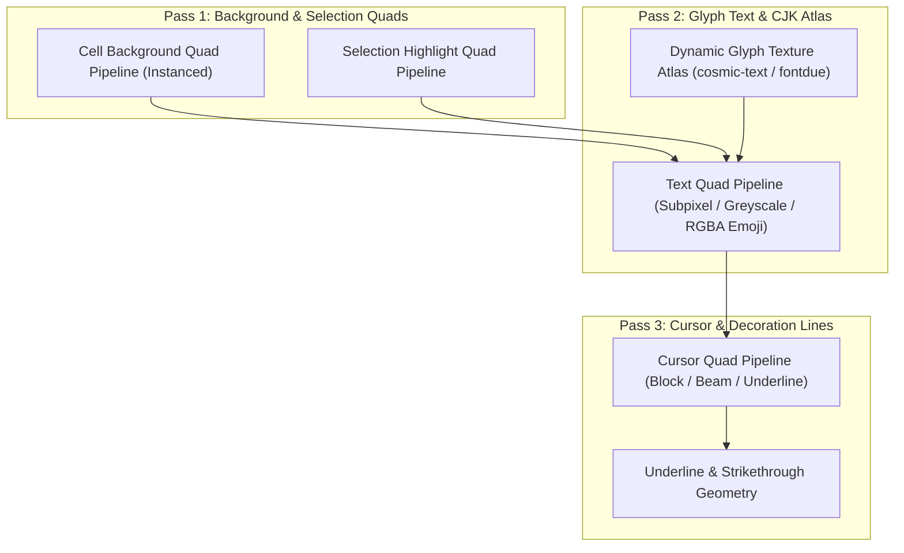

# 03. wgpu GPU 渲染管線與文字排版規格 (GPU Rendering Pipeline)

## 1. 渲染架構與目標
- **後端支援**：macOS (Metal)、Windows (DirectX 12 / Vulkan)、Linux (Vulkan / OpenGL)。
- **目標幀率**：支援 60Hz / 120Hz+ ProMotion / G-Sync。
- **零閒置耗電 (Damage Tracking)**：僅在畫面網格存在 Dirty lines、游標閃爍或動畫時提交 GPU RenderPass。

---

## 2. 渲染階段劃分 (Render Pipeline Passes)

渲染分為三層主要的繪圖流程：

---

## 3. 動態 Glyph Atlas 與智慧字體選擇 (`atlas.rs`)
- **動態紋理快取**：維護一張尺寸為 2048x2048 的動態 GPU 紋理（`wgpu::TextureFormat::R8Unorm` 為灰階文字，`Rgba8UnormSrgb` 為彩色 Emoji），利用 LRU 演算法管理字元快取。
- **VSCode 風格多字體回退串列 (Font Family Fallback List)**：
  - 支援以逗號分隔的多字體設定（例如 `"JetBrains Mono, Menlo, PingFang TC"`），依序查找字元 Glyph，完美兼顧西文等寬程式碼字體與繁體中文/日文/韓文（CJK）字型美觀。
- **智慧字重與樣式匹配演算法 (Smart Font Face Selection)**：
  - 當系統字體家族包含數十種變體（如 Condensed、Expanded、Light、SemiBold、Italic）時，自動剝離樣式後綴精確比對家族名稱（Exact Match > Prefix Match > Substring）。
  - 預設優先選擇標準寬度（Regular Width）字重，並根據 `CellFlags::BOLD` / `ITALIC` 精準匹配對應的粗體或斜體字面（Face），避免選錯窄體或過細字型。

---

## 4. 程序化無縫框線與區塊元素繪製 (`skterm_render::box_drawing`)
- 針對 Unicode 框線字元（Box Drawing `U+2500..U+257F`）與區塊元素（Block Elements `U+2580..U+259F`，如半高/四分之一方塊、漸層陰影），**繞過字型檔案光柵化**，直接於 GPU 頂點管線中根據當前單元格精確像素尺寸（`cell_width` × `cell_height`）以幾何矩形程序化生成。
- 徹底消除因調整 `line_height` 或字型 metric 誤差導致的 `tmux`、`btop`、`lazygit`、`neovim` 表格斷線、邊框縫隙與進度條破圖問題。

---

## 5. 主題色彩即時切換、`bold_is_bright` 與 UI 圖層整合
- **零重建即時變色 (Zero-Rebuild Theme Updates)**：
  - 主題色彩（背景、前景、游標、選取區、16 色 ANSI 調色盤）封裝於輕量 GPU Uniform 緩衝區，切換主題時僅需呼叫 `queue.write_buffer` 與 `request_redraw()`，無需重建 WGPU 管線與 Atlas 快取。
- **粗體自動高亮 (`bold_is_bright`)**：
  - 當啟用 `bold_is_bright` 時，帶有 SGR 1 (`CellFlags::BOLD`) 屬性的文字若使用 ANSI 0..7 標準色，自動提升為對應的 8..15 高亮色；若為預設前景色則自動提升為高對比純白 `#FFFFFF`，確保深色主題下層次分明。
- **互動式捲軸、搜尋覆蓋層與全域 AI 面板 (`AgentPanelLayout`)**：
  - 渲染器原生整合右側平滑捲軸 (`ScrollbarMetrics`)、即時搜尋高亮框 (`Cmd+F`) 以及右側全域 AI Agent 面板 (`skterm_render::agent_panel::AgentPanelLayout`)，繪圖像素與 GUI 滑鼠點擊判定共用同一組單一來源幾何結構，確保 100% 像素對齊。
